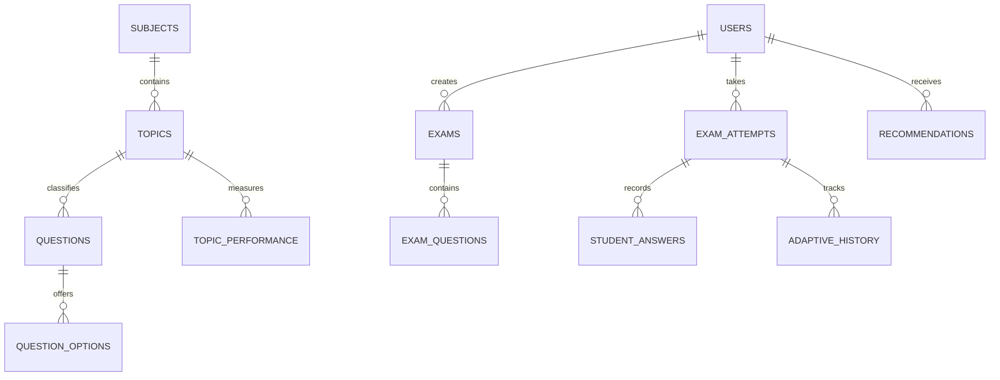

# AdaptIQ

AdaptIQ is a JavaFX desktop application for role-based learning and examination management. It supports fixed-question normal examinations, a transparent rule-based adaptive-engine core, automatic result calculation, topic-level performance tracking, recommendations, analytics, and PDF-report services.

## Problem statement and objectives

Conventional examinations use one fixed difficulty for every student and rarely turn results into actionable feedback. AdaptIQ records actual answers, measures performance at topic level, adjusts adaptive difficulty through clear rules, and recommends suitable practice.

## Technology stack

- Java 21 target, JavaFX/FXML/CSS, Maven
- MySQL 8, JDBC, prepared statements, InnoDB transactions
- BCrypt, SLF4J/Logback, OpenPDF, JUnit 5

## Architecture

```text
FXML views -> JavaFX controllers -> services -> DAOs -> JDBC -> MySQL
```

Controllers handle UI events; services own authorization, evaluation, and adaptive rules; DAOs own SQL and resource handling. Passwords are BCrypt hashes only.

## Features implemented in source

- Student-only self-registration, secure login/logout, role checks, audit logging
- Separate student, faculty, and administrator dashboards using live database queries
- Subject/topic maintenance and validated faculty MCQ question bank
- Published normal examinations, persisted attempts, countdown, evaluation, and topic performance updates
- Adaptive rule engine and adaptive history persistence adapter
- Student analytics, recommendations, and PDF report service

## Database setup

1. Execute `database/adaptiq_schema.sql` in MySQL Workbench.
2. Optionally execute `database/seed_data.sql`.
3. Copy the safe configuration template:

```powershell
Copy-Item config/application.properties.example config/application.properties
```

4. Set the local `db.url`, `db.username`, and `db.password` in `config/application.properties`. This file is ignored by Git.

Register accounts through the app. To bootstrap the first administrator/faculty account, promote separately registered accounts in MySQL, then sign in again:

```sql
UPDATE users SET role = 'ADMIN' WHERE email = 'admin@example.com';
UPDATE users SET role = 'FACULTY' WHERE email = 'faculty@example.com';
```

## Build and run

Requirements: JDK 21, Maven 3.9+, MySQL 8, and network/proxy access for Maven's initial dependency download.

```powershell
mvn clean test
mvn javafx:run
```

## Adaptive algorithm

The initial difficulty is MEDIUM. The engine assesses the latest five valid answers (or all available answers):

| Recent accuracy | Next difficulty |
| --- | --- |
| At least 80% | One level higher |
| 50% to 79.99% | Unchanged |
| Below 50% | One level lower |

Difficulty is bounded by EASY and HARD. Previously shown questions are excluded; the closest available difficulty is selected when the requested one has no unused question.

## Data model



## Tests and verification status

JUnit source tests cover authentication, dashboard authorization, question validation, and adaptive rules. FXML documents have been XML-validated. Maven was unavailable in the development environment, so compilation, database integration tests, and JUnit execution are not claimed as passing.

## Current limitations and next verification steps

- Install/configure Maven, then run `mvn clean test` and `mvn javafx:run`.
- Configure MySQL and complete the end-to-end role workflow with real records.
- The adaptive engine core and history DAO need final integration into a student adaptive-exam screen.
- Verify PDF export after OpenPDF is resolved by Maven.
