<div align="center">

# AdaptIQ

### Adaptive Learning & Intelligent Examination Platform

**Learn with clarity. Assess with confidence.**

[](https://www.oracle.com/java/)
[](https://openjfx.io/)
[](https://maven.apache.org/)
[](https://www.mysql.com/)
[]()

</div>

---

## Contents

- [About AdaptIQ](#-about-adaptiq)
- [Problem statement](#-problem-statement)
- [Core capabilities](#-core-capabilities)
- [Technology stack](#-technology-stack)
- [Role-based modules](#-role-based-modules)
- [Application screenshots](#-application-screenshots)
- [System architecture](#-system-architecture)
- [Application workflows](#-application-workflows)
- [Entity relationship diagram](#-entity-relationship-diagram)
- [Adaptive algorithm](#-adaptive-algorithm)
- [Project structure](#-project-structure)
- [Database configuration](#-database-configuration)
- [Build and run](#-build-and-run)
- [Demo accounts](#-demo-accounts)
- [Testing and verification](#-testing-and-verification)
- [Current limitations](#-current-limitations)
- [Security](#-security-notes)
- [Contributors](#-contributors)

---

## 🎓 About AdaptIQ

**AdaptIQ** is a JavaFX desktop application for role-based learning and examination management. It brings academic content management, assessments, automatic evaluation, topic-level performance tracking, personalised practice recommendations, analytics, and PDF-report services into one platform.

The application is designed around three user roles:

- **Administrator** — oversees the platform and academic catalogue.
- **Faculty** — maintains the question bank and creates examinations.
- **Student** — attempts examinations and uses performance insights to identify topics that need more practice.

AdaptIQ supports fixed-question normal examinations and includes a transparent, rule-based adaptive-engine core.

## 🎯 Problem statement

Traditional examination systems generally present the same difficulty level to every learner and often provide limited feedback beyond a final score. This makes it difficult for students to identify weak topics and choose what to practise next.

AdaptIQ aims to make assessment more useful by:

1. Organising questions by subject and topic.
2. Recording student answers and examination outcomes.
3. Measuring performance at topic level.
4. Applying transparent rules to adjust adaptive difficulty.
5. Recommending suitable practice based on performance.

## ✨ Core capabilities

| Module | Capabilities |
|---|---|
| Authentication | Student self-registration, secure login/logout, role checks, audit logging |
| Admin workspace | System overview and subject/topic maintenance |
| Faculty workspace | Question bank management and examination creation |
| Question bank | Validated MCQs with options, correct answer, difficulty, topic, and marks |
| Normal examinations | Fixed-question examinations with publication and duration settings |
| Exam attempt | Countdown timer, question navigation, answer persistence, submission |
| Evaluation | Automatic score, percentage, correct, incorrect, and unanswered counts |
| Learning insights | Topic-level performance, recommendations, and student analytics |
| Adaptive core | Rule-based difficulty adjustment and adaptive-history persistence adapter |
| Reports | PDF-report service using OpenPDF |

## 🧰 Technology stack

| Area | Technology |
|---|---|
| Language | Java 21 |
| Desktop UI | JavaFX |
| View definitions | FXML |
| Styling | JavaFX CSS |
| Build | Apache Maven |
| Database | MySQL 8 |
| Data access | JDBC, prepared statements, InnoDB transactions |
| Password hashing | BCrypt |
| Logging | SLF4J / Logback |
| PDF generation | OpenPDF |
| Tests | JUnit 5 |

## 👥 Role-based modules

### Administrator

- Access the administrator dashboard.
- View platform-level account and assessment information.
- Maintain the subject and topic catalogue.
- Provision privileged accounts through controlled administration.

### Faculty

- Access the faculty dashboard.
- Create and maintain MCQ questions.
- Assign questions to topics and difficulty levels.
- Create normal examinations using fixed questions.
- Set examination title, description, and duration.
- Publish examinations for students.

### Student

- Register through the student registration screen.
- View available published examinations.
- Start an examination and answer questions.
- Submit answers or allow the timer to trigger submission.
- View the result and performance analytics.
- Use topic-level recommendations to guide further practice.

## 🖥️ Application screenshots

Screenshots are included as **separate image files** in the [`Screenshots/`](Screenshots/) folder at the project root.

### Authentication

**Login**

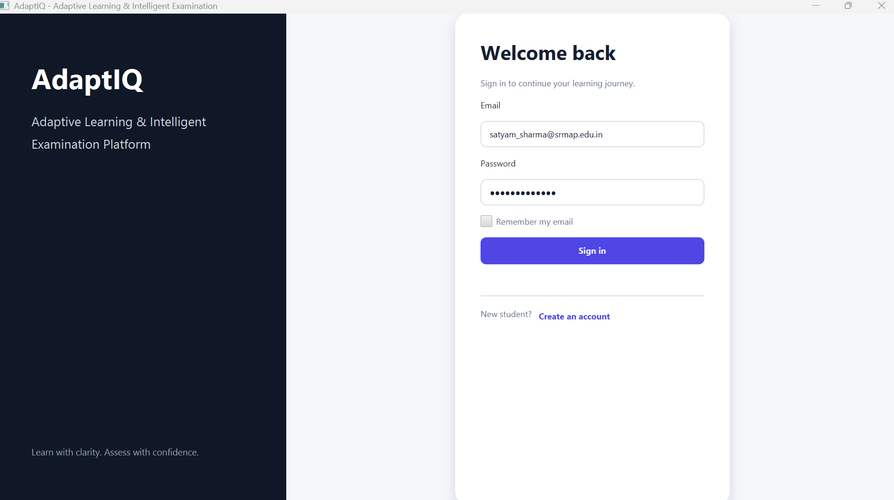

**Student registration**

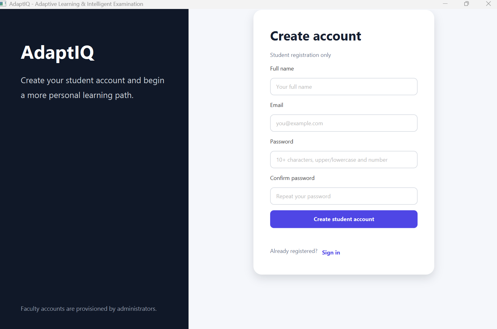

### Administrator

**Administrator dashboard**

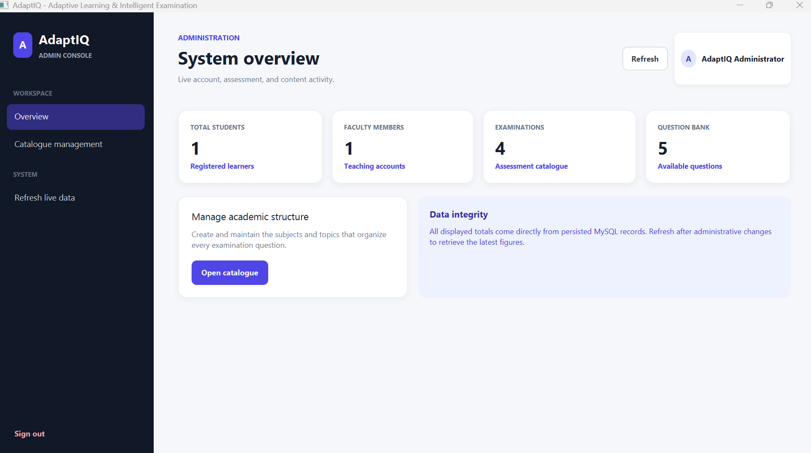

**Subject and topic catalogue**

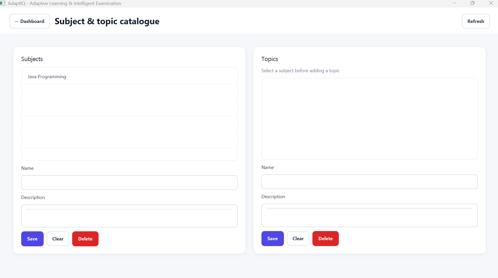

### Faculty

**Faculty dashboard**


**Question bank**

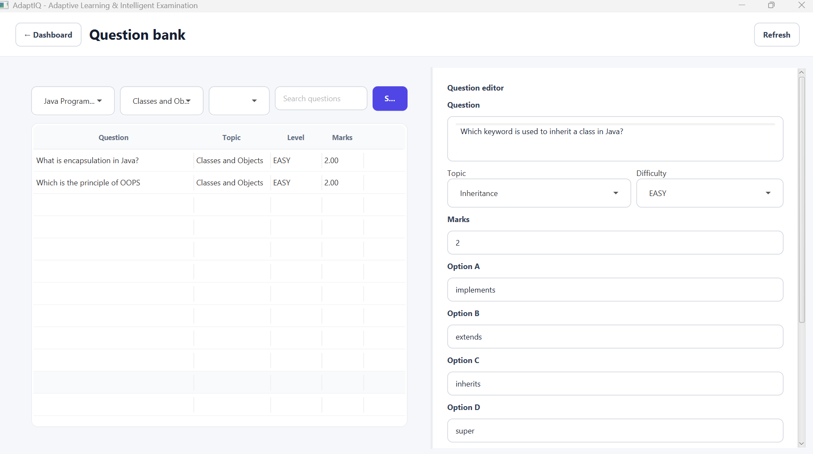

**Question editor**

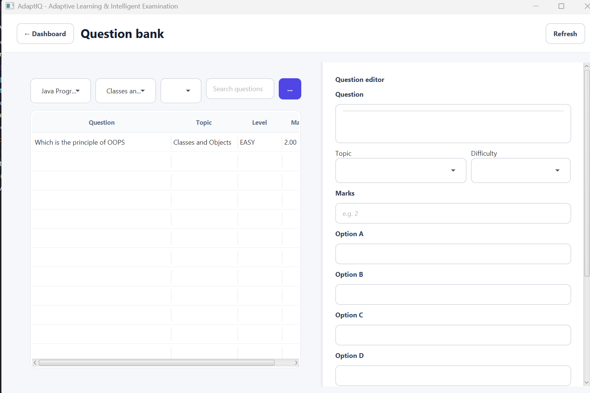

**Create an examination**

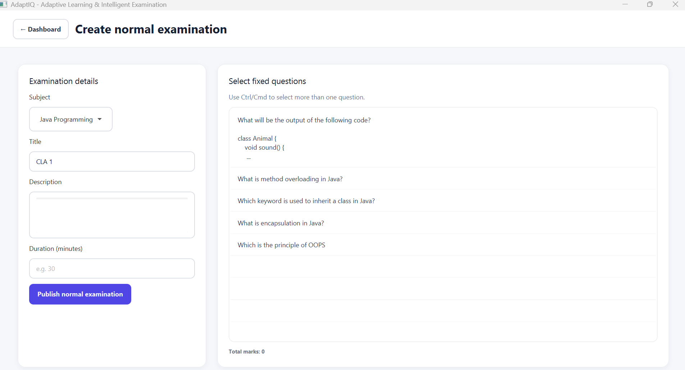

**Select fixed questions**

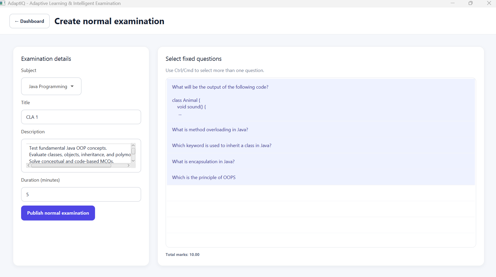

**Faculty examination overview**

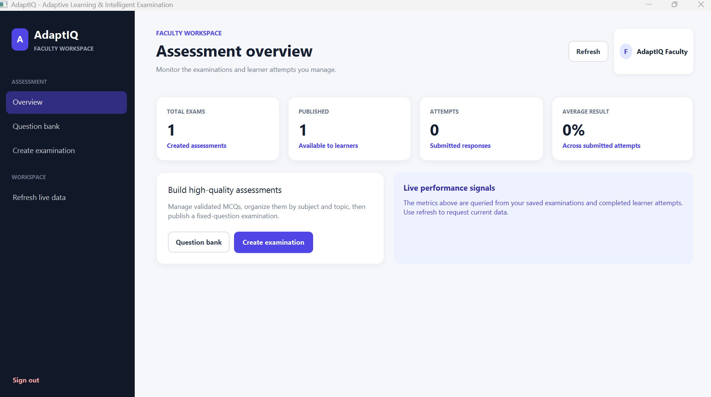

### Student examination and analytics

**Available examinations**

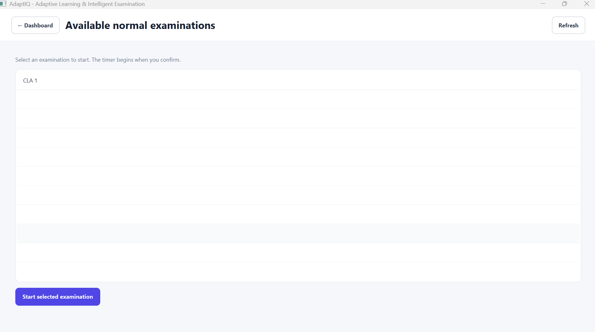

**Examination result**

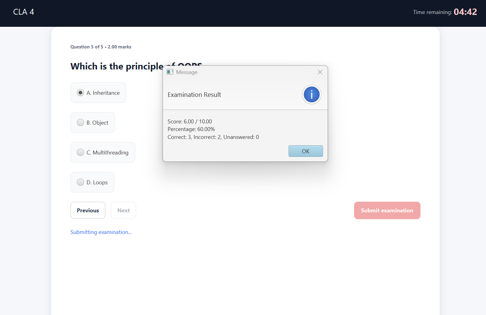

**Student dashboard**

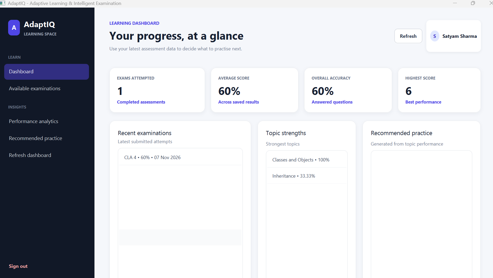

**Student performance analytics**

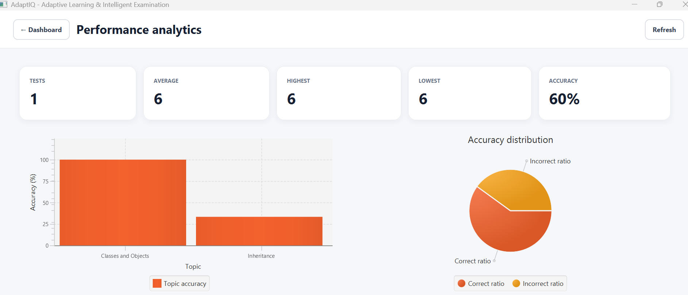

**Analytics charts**

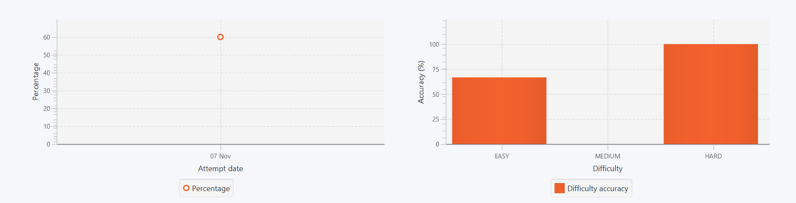

## 🏛️ System architecture

AdaptIQ uses a layered architecture. The JavaFX presentation layer receives user interactions and delegates work to controllers. Controllers coordinate with services, which own application rules such as authentication, authorization, examination processing, evaluation, and adaptive logic. DAO classes handle database access through JDBC.

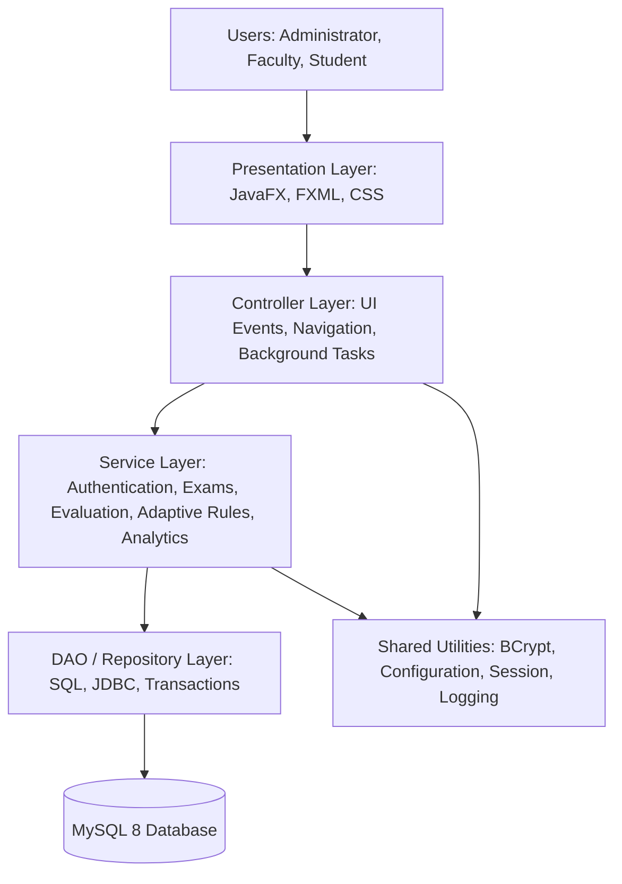

### Layer responsibilities

| Layer | Responsibility |
|---|---|
| Presentation | Displays FXML screens and captures user input |
| Controller | Handles screen events, navigation, and asynchronous UI tasks |
| Service | Applies business rules, role checks, evaluation, and adaptive logic |
| DAO / Repository | Executes parameterised SQL and manages database resources |
| Model | Represents users, questions, examinations, attempts, and results |
| Utilities | Provides shared session, configuration, security, and logging support |
| Database | Persists user accounts, academic content, attempts, answers, and performance data |

## 🔄 Application workflows

### 1. Login and role routing

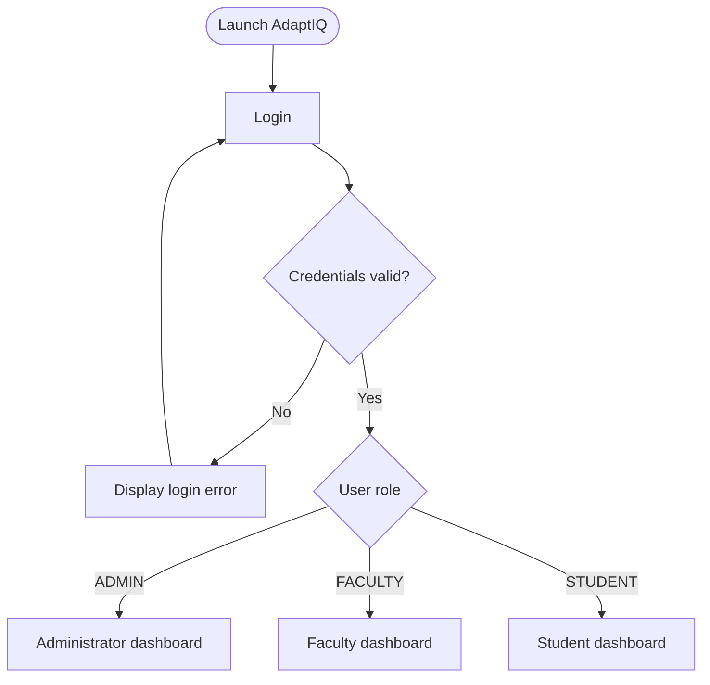

### 2. Faculty examination creation

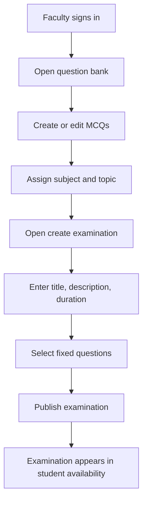

### 3. Student examination and result processing

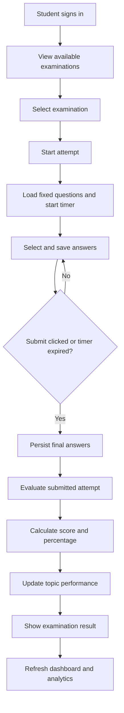

## 🗃️ Entity relationship diagram

The diagram below is a conceptual overview of the main entities and relationships represented by the project database. For exact column definitions and constraints, use [`database/adaptiq_schema.sql`](database/adaptiq_schema.sql) as the source of truth.

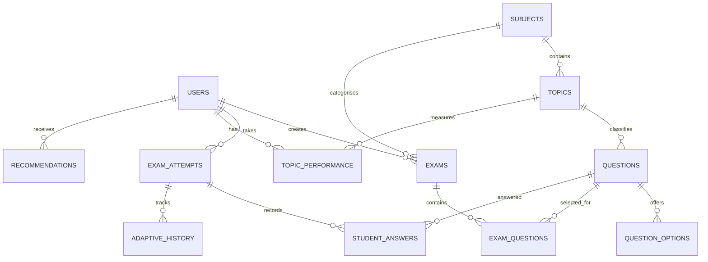

## 🧠 Adaptive algorithm

The adaptive-engine core uses a transparent rule-based approach. It begins at **MEDIUM** difficulty and evaluates the learner's recent valid answers.

| Accuracy across recent answers | Next difficulty |
|---|---|
| 80% or higher | Increase by one difficulty level |
| 50% to 79.99% | Keep the current difficulty |
| Below 50% | Decrease by one difficulty level |

Additional rules:

- The engine considers the latest five valid answers, or all available answers when fewer than five exist.
- Difficulty is bounded between **EASY** and **HARD**.
- Previously shown questions are excluded.
- If no unused question exists at the requested difficulty, the closest available difficulty is selected.

The adaptive engine core and adaptive-history persistence adapter are present in the source. The student-facing adaptive examination flow still requires final integration; see [Current limitations](#-current-limitations).

## 📁 Project structure

```text
AdaptIQ/
├── Screenshots/
│   ├── login.png
│   ├── student-registration.png
│   ├── admin-dashboard.png
│   └── ... (other screenshot files)
├── config/
│   ├── application.properties.example
│   └── application.properties
├── database/
│   ├── adaptiq_schema.sql
│   └── seed_data.sql
├── src/
│   ├── main/
│   │   ├── java/com/adaptiq/
│   │   │   ├── config/
│   │   │   ├── controller/
│   │   │   ├── dao/
│   │   │   ├── exception/
│   │   │   ├── model/
│   │   │   ├── service/
│   │   │   └── util/
│   │   └── resources/
│   │       ├── css/
│   │       └── fxml/
│   └── test/
├── .gitignore
├── pom.xml
└── README.md
```

## 🗄️ Database configuration

### Prerequisites

- JDK 21
- Maven 3.9+
- MySQL 8
- Internet or proxy access for Maven's initial dependency download

### 1. Create the database

Open MySQL Workbench and execute the schema file:

```text
database/adaptiq_schema.sql
```

Optionally load the sample records:

```text
database/seed_data.sql
```

### 2. Create the local configuration file

In Windows PowerShell, from the project root:

```powershell
Copy-Item config/application.properties.example config/application.properties
```

Set the local database properties in `config/application.properties`:

```properties
db.url=jdbc:mysql://localhost:3306/adaptiq_db?useSSL=false&allowPublicKeyRetrieval=true&serverTimezone=UTC
db.username=YOUR_MYSQL_USERNAME
db.password=YOUR_LOCAL_MYSQL_PASSWORD
```

Use your own local MySQL username and password. The `application.properties` file is ignored by Git; do not commit it.

### 3. Provision administrator and faculty accounts

Public self-registration is intended for students. To promote separately registered accounts for local development, update their roles in MySQL:

```sql
UPDATE users
SET role = 'ADMIN'
WHERE email = 'admin@example.com';

UPDATE users
SET role = 'FACULTY'
WHERE email = 'faculty@example.com';
```

Use the actual email addresses stored in your local database. Sign out and sign in again after changing a role.

## ▶️ Build and run

From the project root:

```powershell
mvn clean test
mvn javafx:run
```

To create the Maven package:

```powershell
mvn clean package
```

## 🔐 Demo accounts

The following account details were used for the local demonstration. Treat them as temporary demo credentials only.

| Role | Email | Password |
|---|---|---|
| Administrator | `admin@adaptiq.com` | Shared privately |
| Faculty | `faculty@adaptiq.com` | Shared privately |
| Student | `satyam_sharma@srmap.edu.in` | Shared privately |

**Important:** Do not publish real or reused passwords in a public GitHub repository. Share demo credentials privately and rotate them after demonstrations. Never include your MySQL password or `config/application.properties` in the repository.

## 🧪 Tests and verification status

The project includes JUnit source tests covering:

- Authentication
- Dashboard authorization
- Question validation
- Adaptive difficulty rules

FXML documents have been XML-validated.

**Verification note:** The project status supplied for this README states that Maven was unavailable in the development environment. Therefore, successful compilation, JUnit execution, and full database integration testing are not claimed here. Run the commands in [Build and run](#-build-and-run) in an environment with JDK 21, Maven, and MySQL configured.

## 🚧 Current limitations and next steps

- Install/configure Maven and run `mvn clean test`.
- Run the application with a configured MySQL database and verify the full administrator, faculty, and student workflows.
- Complete integration of the adaptive engine into a student-facing adaptive examination screen.
- Verify PDF export after resolving OpenPDF through Maven.
- Perform end-to-end testing of saved answers, evaluation, topic-performance updates, and analytics.

## 🔒 Security notes

- Store password hashes, never plaintext passwords.
- Use parameterised SQL statements.
- Keep local database credentials out of Git.
- Restrict administrator and faculty account provisioning.
- Validate user roles and account status during authentication.
- Remove or rotate demo credentials before sharing a public build.

---

## 👨‍💻 Contributors

- **Satyam Sharma**
- **Arshika Singh**

---

<div align="center">

**AdaptIQ — Learn with clarity. Assess with confidence.**

</div>
