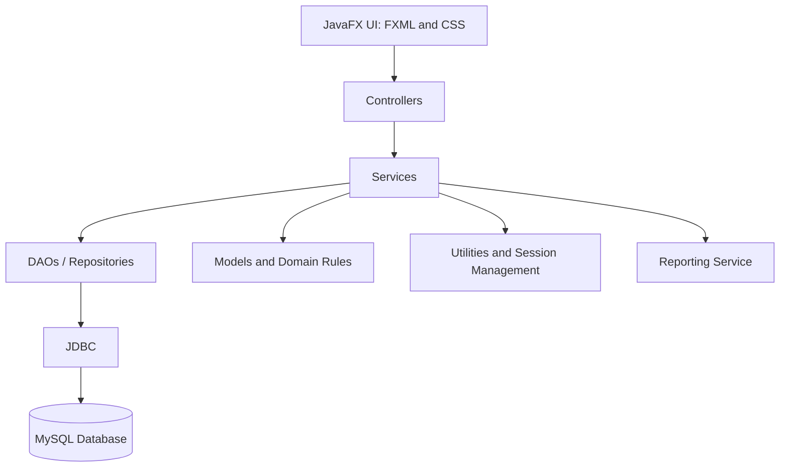
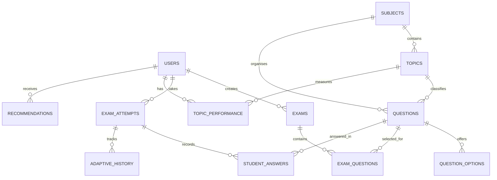
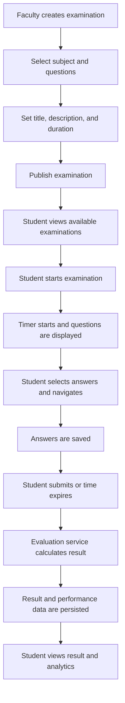

# AdaptIQ

## Adaptive Learning & Intelligent Examination Platform

**Project Report**\
**Project Type:** Java Desktop Application\
**Primary Language:** Java\
**Academic Year:** 2026\
**Version:** 1.0

------------------------------------------------------------------------

## Abstract

AdaptIQ is a JavaFX-based desktop application designed to bring
learning, assessment, and performance analysis together in one
role-based platform. It provides separate workspaces for students,
faculty members, and administrators. Faculty can maintain academic
content, manage a question bank, and create and publish fixed-question
examinations. Students can take examinations through a timed interface
and review their results, topic-level performance, analytics, and
recommended practice. Administrators can view system-level information
and maintain the academic subject and topic catalogue.

The application uses Java for application logic, JavaFX with FXML and
CSS for the desktop interface, Maven for dependency and build
management, and MySQL for persistent storage. JDBC and prepared
statements are used for database access. Passwords are stored as BCrypt
hashes rather than plaintext. The project also contains an adaptive-rule
engine designed to adjust question difficulty based on recent
performance. The adaptive engine's integration into a complete
student-facing adaptive examination flow remains a verification and
integration item, as described in this report.

------------------------------------------------------------------------

## 1. Introduction

### 1.1 Background

Traditional assessment systems commonly present students with a fixed
set of questions and provide a final score. A score alone may not
explain which topics a student understands well, where the student is
struggling, or what should be practised next.

AdaptIQ addresses this problem by combining examination management with
performance tracking and learning support. It records examination
attempts and answers, calculates results, aggregates performance by
topic, and presents analytics and practice recommendations. Its
adaptive-engine component provides a rule-based foundation for selecting
a suitable next difficulty level.

### 1.2 Problem Statement

A conventional examination workflow may not provide: - A unified
environment for administrators, faculty, and students. - Structured
management of subjects, topics, questions, and examinations. - A timed
examination experience with persisted answers and automatic
evaluation. - Topic-level analysis of student performance. - Actionable
practice recommendations based on assessment results. - A transparent
mechanism for adjusting question difficulty using recent performance.

### 1.3 Proposed Solution

AdaptIQ provides a role-based desktop platform with: 1. Student
registration and authenticated access. 2. Administrator, faculty, and
student dashboards. 3. Subject and topic catalogue management. 4.
Faculty question-bank management. 5. Creation and publication of
fixed-question normal examinations. 6. Timed student examination
attempts. 7. Automatic result calculation and persistence. 8. Student
performance analytics and topic-level insights. 9. Recommended practice
based on recorded performance. 10. A rule-based adaptive-engine core and
adaptive-history persistence support.

### 1.4 Objectives

-   Build a maintainable Java desktop application.
-   Separate user-interface, business-logic, and database
    responsibilities.
-   Provide role-specific access and workflows.
-   Store application data reliably in MySQL.
-   Support timed examinations and automatic evaluation.
-   Convert examination outcomes into topic-level performance
    information.
-   Provide a foundation for adaptive question selection.
-   Apply secure password hashing and parameterized database queries.

------------------------------------------------------------------------

## 2. Scope

### 2.1 Included in the Project

-   JavaFX desktop user interface.
-   Student self-registration.
-   Role-based authentication and dashboards.
-   Administrator subject/topic catalogue interface.
-   Faculty question-bank interface.
-   Normal examination creation and publication.
-   Student examination attempt, countdown, answer capture, and
    submission.
-   Automatic scoring and saved results.
-   Student analytics and practice recommendations.
-   Adaptive difficulty rules and history persistence components.
-   Database schema and seed data scripts.


### 2.2 Outside the Current Verified Scope

The following should not be presented as fully completed without
additional implementation and testing: - A complete, end-to-end
student-facing adaptive examination workflow. - Production deployment of
the JavaFX desktop application to a browser-hosted platform. -
Production-grade cloud database and server deployment. - Verified PDF
export in the target runtime. - Verified multi-user concurrency and load
testing. - Verified backup, recovery, and production security
procedures.

------------------------------------------------------------------------

## 3. Users and Roles

### 3.1 Student

The student workspace supports: - Student account registration and
login. - Viewing the student dashboard. - Viewing available published
normal examinations. - Starting and completing timed examinations. -
Navigating between questions and selecting answers. - Submitting an
examination and receiving a result. - Viewing recent examinations and
performance summaries. - Reviewing topic strengths and recommended
practice. - Viewing performance analytics.

### 3.2 Faculty

The faculty workspace supports: - Faculty login through an
administrator-provisioned account. - Viewing an assessment overview. -
Managing questions in the question bank. - Organising questions by
subject and topic. - Setting question difficulty and marks. - Creating
examinations by selecting fixed questions. - Setting examination details
and duration. - Publishing normal examinations. - Viewing examination
and attempt summary information.

### 3.3 Administrator

The administrator workspace supports: - Administrator login through a
provisioned account. - Viewing system overview metrics. - Viewing
student, faculty, examination, and question-bank totals. - Opening the
subject and topic catalogue. - Maintaining academic structure through
the catalogue interface. - Refreshing dashboard information.

Public self-registration is intended for students. Faculty and
administrator accounts are provisioned separately.

------------------------------------------------------------------------

## 4. Functional Requirements

  -----------------------------------------------------------------------
  ID                      Requirement             Description
  ----------------------- ----------------------- -----------------------
  FR-01                   Registration            A student can create an
                                                  account.

  FR-02                   Authentication          A registered user can
                                                  sign in using valid
                                                  credentials.

  FR-03                   Role-based navigation   Users are directed to
                                                  the workspace
                                                  associated with their
                                                  role.

  FR-04                   Academic catalogue      Academic subjects and
                                                  topics can be
                                                  maintained.

  FR-05                   Question bank           Faculty can create and
                                                  manage multiple-choice
                                                  questions.

  FR-06                   Question classification Questions are
                                                  associated with topics
                                                  and difficulty levels.

  FR-07                   Examination creation    Faculty can create an
                                                  examination using
                                                  selected fixed
                                                  questions.

  FR-08                   Publication             Faculty can publish a
                                                  normal examination for
                                                  students.

  FR-09                   Timed attempt           A student examination
                                                  attempt uses a
                                                  countdown timer.

  FR-10                   Answer persistence      Selected answers are
                                                  saved against an
                                                  examination attempt.

  FR-11                   Evaluation              The system calculates
                                                  marks and answer counts
                                                  on submission.

  FR-12                   Performance tracking    Results can contribute
                                                  to topic-level
                                                  performance summaries.

  FR-13                   Analytics               Students can view
                                                  assessment and
                                                  performance summaries.

  FR-14                   Recommendations         Practice
                                                  recommendations are
                                                  generated from topic
                                                  performance.

  FR-15                   Adaptive rules          Recent answer accuracy
                                                  can determine a
                                                  proposed next
                                                  difficulty.

  
------------------------------------------------------------------------

------------------------------------------------------------------------

## 5. Non-Functional Requirements

### 5.1 Security

-   Passwords are hashed using BCrypt.
-   SQL operations use prepared statements where applicable.
-   Role checks are applied to protected application workflows.
-   Database credentials are kept in a local configuration file or
    environment variables.
-   The local `config/application.properties` file must not be committed
    to source control.

### 5.2 Maintainability

-   The codebase is separated into configuration, controller, DAO,
    model, service, exception, and utility packages.
-   FXML separates view definitions from Java controller code.
-   Maven declares external dependencies in one project configuration
    file.

### 5.3 Reliability

-   Examination attempts and answers are persisted.
-   Database access is centralised through database
    connection/configuration classes.
-   Database operations use transaction support where required.
-   Errors are surfaced through application status messages and
    exception handling.

### 5.4 Usability

-   Separate dashboards are provided for each user role.
-   Examination screens provide question navigation and a visible timer.
-   Results and analytics are presented in dedicated views.

------------------------------------------------------------------------

## 6. Technology Stack

  -----------------------------------------------------------------------
  Technology                          Purpose
  ----------------------------------- -----------------------------------
  Java 21                             Core programming language and
                                      application logic

  JavaFX 21.0.5                       Desktop UI framework

  FXML                                Declarative JavaFX view layout

  JavaFX CSS                          Application styling

  Maven                               Dependency management, build
                                      lifecycle, testing, and packaging

  MySQL 8                             Relational database

  JDBC                                Java-to-MySQL connectivity

  MySQL Connector/J 8.4.0             MySQL JDBC driver

  BCrypt (`jbcrypt` 0.4)              Password hashing and verification

  SLF4J / Logback                     Application logging

  OpenPDF                             PDF report generation component

  JUnit 5                             Unit testing
  -----------------------------------------------------------------------

### 6.1 Why Maven?

Maven manages the project's dependencies and build process through
`pom.xml`. It downloads declared libraries, compiles the Java source,
runs tests, and packages the application. This helps team members build
the same project with a consistent dependency configuration.

------------------------------------------------------------------------

## 7. System Architecture

AdaptIQ follows a layered architecture.



### 7.1 Presentation Layer

The presentation layer consists of JavaFX views defined in FXML and
styled with CSS. It displays forms, dashboards, question lists,
examination screens, results, and analytics.

### 7.2 Controller Layer

Controllers respond to UI events, read user input, invoke services, and
update the views. They should not contain SQL statements or duplicate
business rules.

### 7.3 Service Layer

Services coordinate business operations such as authentication,
examination creation, answer saving, examination submission, evaluation,
analytics, and adaptive rules.

### 7.4 Data Access Layer

DAOs and repositories execute database operations. They use JDBC and
prepared statements to read and write persistent data.

### 7.5 Database Layer

MySQL stores user accounts, academic catalogue information, questions,
examinations, attempts, answers, results, and performance-related
records.

### 7.6 Supporting Components

-   `DatabaseConnection` loads database configuration and creates JDBC
    connections.
-   `ConnectionProvider` abstracts connection acquisition.
-   `SessionManager` and `ExamSessionManager` maintain relevant session
    state.
-   `PasswordUtil` provides BCrypt password hashing and verification.
-   Logging and exception classes support diagnostics and error
    handling.

------------------------------------------------------------------------

## 8. Application Package Structure

The main Java package is `com.adaptiq`.

``` text
AdaptIQ/
├── config/
│   ├── application.properties                 # Local only; do not commit
│   └── application.properties.example         # Safe configuration template
├── database/
│   ├── adaptiq_schema.sql
│   └── seed_data.sql
├── docs/
│   └── screenshots/
├── src/
│   ├── main/
│   │   ├── java/com/adaptiq/
│   │   │   ├── config/
│   │   │   ├── controller/
│   │   │   ├── dao/
│   │   │   ├── exception/
│   │   │   ├── model/
│   │   │   ├── service/
│   │   │   └── util/
│   │   └── resources/
│   │       ├── css/
│   │       └── fxml/
│   └── test/
│       └── java/
├── .gitignore
├── pom.xml
└── README.md
```

The exact contents may evolve as modules are added. The local database
properties file is intentionally excluded from Git.

------------------------------------------------------------------------

## 9. Database Design

### 9.1 Database

-   Database name: `adaptiq_db`
-   Database engine: MySQL 8
-   Connection is configured using JDBC.

Example local JDBC URL:

``` properties
db.url=jdbc:mysql://localhost:3306/adaptiq_db?useSSL=false&allowPublicKeyRetrieval=true&serverTimezone=UTC
```

The database username and password are supplied in the local
configuration file or through environment variables. Real credentials
must not be placed in this report or committed to Git.

### 9.2 Main Data Entities

The schema and application refer to the following principal entities:

  -----------------------------------------------------------------------
  Entity                              Responsibility
  ----------------------------------- -----------------------------------
  `users`                             User identity, role, account
                                      status, and password hash

  `subjects`                          Academic subjects

  `topics`                            Topics belonging to subjects

  `questions`                         Question text, topic, difficulty,
                                      and marks

  `question_options`                  Multiple-choice options and
                                      correct-answer metadata

  `exams`                             Examination metadata and
                                      publication information

  `exam_questions`                    Questions associated with an
                                      examination

  `exam_attempts`                     Student examination attempts

  `student_answers`                   Answers recorded during an attempt

  `adaptive_history`                  History associated with adaptive
                                      decisions

  `topic_performance`                 Student performance aggregated by
                                      topic

  `recommendations`                   Practice recommendations for
                                      students
  -----------------------------------------------------------------------

The exact columns, constraints, and foreign-key definitions are
specified in `database/adaptiq_schema.sql`.

### 9.3 Entity Relationship Diagram

The following conceptual ER diagram shows the principal relationships.
Consult the SQL schema for the exact physical database definition.



------------------------------------------------------------------------

## 10. Core Module Design

### 10.1 Authentication and Account Management

The authentication workflow validates user input, retrieves the relevant
account, checks the supplied password against its BCrypt hash, verifies
account status and role, and establishes the application session.

Student registration is exposed through the public registration screen.
Faculty and administrator accounts are provisioned separately to prevent
unrestricted creation of privileged accounts.

### 10.2 Administrator Module

The administrator dashboard displays live summary values for students,
faculty members, examinations, and questions. The catalogue interface
provides subject and topic maintenance.

### 10.3 Faculty Module

The faculty module supports question-bank maintenance and normal
examination creation. Questions are associated with academic topics,
difficulty levels, marks, and multiple-choice options. An examination is
assembled from selected fixed questions and published with its duration
and other metadata.

### 10.4 Student Module

The student dashboard summarises assessment activity and performance.
Students can view available normal examinations, start an attempt,
answer questions, navigate through the examination, and submit their
responses.

### 10.5 Normal Examination Module

The normal examination workflow is:



### 10.6 Examination Timer

The examination screen displays the remaining time. The controller
updates the timer periodically and initiates submission when the
remaining time reaches zero. Submission is performed asynchronously so
that database operations do not block the JavaFX application thread.

The server/database-side attempt state and timestamps should remain the
authoritative source for enforcing time limits. The client countdown is
a user-facing display and trigger, not a substitute for server-side
validation.

### 10.7 Evaluation and Result Calculation

On submission, the examination service processes the saved answers and
calculates the result. The result view reports: - Obtained marks. -
Total marks. - Percentage. - Correct answer count. - Incorrect answer
count. - Unanswered question count.

The result is persisted for later dashboard and analytics queries.

### 10.8 Performance Analytics

The analytics module presents assessment summaries such as: - Number of
tests attempted. - Average, highest, and lowest score. - Overall
accuracy. - Topic-level performance. - Correct and incorrect answer
distribution.

These metrics are intended to help students identify strengths and
topics requiring additional practice.

### 10.9 Recommended Practice

The recommendation component uses recorded topic performance to identify
areas for further practice. Recommendations should be interpreted as
learning guidance generated from the available performance data, not as
a guarantee of future performance.

------------------------------------------------------------------------

## 11. Adaptive Learning Engine

### 11.1 Purpose

The adaptive engine provides a transparent rule-based mechanism for
adjusting the next question difficulty according to recent student
performance.

### 11.2 Difficulty Levels

The engine uses three difficulty levels:

1.  EASY
2.  MEDIUM
3.  HARD

### 11.3 Rule Set

The documented rule is based on the student's latest five valid answers,
or all available answers when fewer than five exist.

  Recent accuracy   Difficulty action
  ----------------- ----------------------------------
  At least 80%      Increase difficulty by one level
  50% to 79.99%     Keep the same difficulty
  Below 50%         Decrease difficulty by one level

The difficulty is bounded: it cannot move below EASY or above HARD.

### 11.4 Question Selection

The intended selection process excludes previously shown questions. If
the requested difficulty has no unused question, the engine can select
the closest available difficulty.

### 11.5 Example

Suppose a student answers five recent questions and gets four correct.

\[ `\text{Accuracy}`{=tex} = `\frac{4}{5}`{=tex}`\times 100`{=tex} = 80%
\]

The rule therefore proposes moving one difficulty level higher, subject
to the HARD limit.

### 11.6 Implementation and Integration Status

The project contains the adaptive rule engine and an adaptive-history
persistence component. The current normal examination flow is
fixed-question based. The adaptive engine still requires final
integration into a complete student-facing adaptive examination screen
and end-to-end verification before the entire adaptive workflow can be
claimed as complete.

------------------------------------------------------------------------

## 12. Security Design

### 12.1 Password Storage

Passwords are processed using BCrypt. The application stores the
resulting password hash rather than the original password. BCrypt uses a
configurable work factor; the project configuration described for this
version uses a work factor of 12.

### 12.2 SQL Injection Prevention

Database operations should use `PreparedStatement` parameters rather
than building SQL statements by concatenating user input.

### 12.3 Role-Based Access

The application distinguishes STUDENT, FACULTY, and ADMIN roles.
Registration is restricted to students, while privileged accounts are
provisioned separately. Protected service operations should validate the
active user's role.

### 12.4 Configuration Protection

Local database settings are stored in `config/application.properties` or
environment variables. The local properties file is ignored by Git. The
example template can be committed because it contains placeholders
rather than secrets.

Environment variable alternatives: - `ADAPTIQ_DB_URL` -
`ADAPTIQ_DB_USERNAME` - `ADAPTIQ_DB_PASSWORD`

**Security note:** Do not publish real database credentials, personal
passwords, or reusable demo passwords in a public repository or project
report. Share demonstration credentials privately and rotate any
credential that has been exposed.

------------------------------------------------------------------------

## 13. User Interface Screens

The application includes distinct screens for authentication,
registration, dashboards, academic catalogue maintenance, question-bank
management, examination creation, examination attempts, results, and
analytics.

Place individual screenshots in `docs/screenshots/`. Use one image per
file rather than combining them into a collage.

Suggested filenames and Markdown embedding:

  Screen                        Suggested image file
  ----------------------------- ------------------------------
  Login                         `login.png`
  Student registration          `register.png`
  Administrator dashboard       `admin-dashboard.png`
  Subject and topic catalogue   `catalogue.png`
  Faculty dashboard             `faculty-dashboard.png`
  Faculty question bank         `question-bank.png`
  Create examination            `create-examination.png`
  Student dashboard             `student-dashboard.png`
  Available examinations        `available-examinations.png`
  Examination screen            `exam-screen.png`
  Examination result            `exam-result.png`
  Student analytics             `performance-analytics.png`

Example:

``` markdown
### Student Dashboard


```

Only add an image reference after the corresponding individual
screenshot has been copied into that path. Do not use placeholder image
links in the final repository.

------------------------------------------------------------------------

## 14. Installation and Configuration

### 14.1 Prerequisites

-   JDK 21.
-   Maven 3.9 or later.
-   MySQL 8.
-   MySQL Workbench (recommended for database administration).
-   Git.
-   An IDE such as Visual Studio Code or IntelliJ IDEA.

### 14.2 Clone the Repository

``` powershell
git clone https://github.com/SATYAM-SHARMA-07/AdaptIQ.git
cd AdaptIQ
```

### 14.3 Create the Database

Open MySQL Workbench and execute:

``` text
database/adaptiq_schema.sql
```

Optionally execute:

``` text
database/seed_data.sql
```

### 14.4 Configure Database Credentials

Create the local configuration file from the example:

``` powershell
Copy-Item config/application.properties.example config/application.properties
```

Edit `config/application.properties` with the local database URL,
username, and password. Do not commit this file.

### 14.5 Build and Test

``` powershell
mvn clean test
```

### 14.6 Run the Application

``` powershell
mvn javafx:run
```

The JavaFX Maven plugin must be configured in `pom.xml` for this
command.

------------------------------------------------------------------------

## 15. Testing and Verification

### 15.1 Test Areas

The project includes JUnit 5 test source code for areas such as: -
Authentication behaviour. - Dashboard authorization. - Question
validation. - Adaptive difficulty rules.

### 15.2 Manual Verification Areas

The following workflows should be tested with a configured MySQL
database: 1. Student registration. 2. Student login and logout. 3.
Administrator login. 4. Faculty login. 5. Subject and topic creation and
maintenance. 6. Question creation and validation. 7. Examination
creation and publication. 8. Student examination start and timer
behaviour. 9. Previous/next question navigation. 10. Answer persistence.
11. Manual submission. 12. Automatic submission on timeout. 13. Result
calculation and persistence. 14. Student dashboard and analytics
refresh. 15. Adaptive engine integration. 16. PDF report generation.

### 15.3 Known Verification Status

Earlier development checks included a successful database connection
test and a Maven test run reporting 14 tests with zero failures and zero
errors. Those results apply to the code state at the time they were run;
rerun the tests after later changes before treating them as the final
release result.

A previous submission defect was identified in `ResultDAO`: a database
numeric value was returned as `BigInteger` but cast directly to `Long`,
causing a `ClassCastException`. The result-mapping code was updated as
part of debugging. Re-run the examination submission workflow and
automated tests against the current code to confirm the fix remains
effective.

Do not claim all integration, deployment, or production tests have
passed unless they have been run and recorded for the final code
version.

------------------------------------------------------------------------

## 16. Current Limitations and Future Enhancements

### 16.1 Current Limitations

-   The complete adaptive examination workflow requires final
    integration and verification.
-   Production deployment infrastructure is not part of the current
    JavaFX desktop build.
-   PDF report generation requires final runtime verification.
-   Cloud database configuration and production operations require
    separate setup.
-   The application needs broader integration, concurrency, and
    usability testing before production use.

### 16.2 Future Enhancements

-   Complete adaptive examination mode with dynamic question selection.
-   Stronger server-side enforcement of examination timing if a
    networked backend is introduced.
-   More detailed faculty reporting and student progress comparisons.
-   Exportable student and faculty reports.
-   Email notifications for examination publication and results.
-   Additional question formats beyond multiple-choice questions.
-   Import/export of question banks.
-   Audit and activity reporting for administrative operations.
-   Automated database backup and recovery procedures.
-   A web version with a browser-based frontend and Java REST API
    backend.
-   Deployment of the web frontend to Vercel and the Java backend to a
    Java-compatible hosting platform, with a managed cloud database.

------------------------------------------------------------------------

## 17. Team Collaboration and Version Control

The project is maintained in Git and hosted in the repository:

**Repository:** https://github.com/SATYAM-SHARMA-07/AdaptIQ

A branch-based workflow is recommended: 1. Keep `main` as the stable
integration branch. 2. Create a separate branch for each feature or
workstream. 3. Commit related changes with descriptive messages. 4. Push
feature branches to GitHub. 5. Review changes before merging into
`main`. 6. Run tests after integration.

Example commands:

``` bash
git switch -c feature-name
git add .
git commit -m "Describe the implemented feature"
git push -u origin feature-name
```

Team members should configure their own local database credentials.
Never share or commit the local `application.properties` file.

------------------------------------------------------------------------

## 18. Conclusion

AdaptIQ brings academic content management, role-based examination
workflows, timed assessments, result calculation, topic-level
performance analysis, and practice recommendations into a single JavaFX
desktop application. Its layered architecture separates presentation,
business logic, and persistence responsibilities, while Maven manages
dependencies and MySQL stores application data.

The rule-based adaptive engine provides a transparent foundation for
adjusting question difficulty based on recent performance. Completing
its integration into the student examination workflow, repeating
end-to-end verification, and validating report generation are important
next steps. With these steps completed, the platform can be further
extended into a browser-accessible learning and assessment system.

------------------------------------------------------------------------

## Appendix A: Useful Maven Commands

  -----------------------------------------------------------------------
  Command                             Description
  ----------------------------------- -----------------------------------
  `mvn clean`                         Removes generated build output.

  `mvn compile`                       Compiles the main source code.

  `mvn test`                          Runs the test suite.

  `mvn package`                       Builds the distributable package.

  `mvn clean test`                    Cleans, compiles, and runs tests.

  `mvn javafx:run`                    Runs the JavaFX application using
                                      the configured plugin.
  -----------------------------------------------------------------------

## Appendix B: Important Project Files

  -----------------------------------------------------------------------------
  File                                      Purpose
  ----------------------------------------- -----------------------------------
  `pom.xml`                                 Maven project and dependency
                                            configuration

  `database/adaptiq_schema.sql`             Database and table definitions

  `database/seed_data.sql`                  Initial seed data

  `config/application.properties.example`   Safe local configuration template

  `README.md`                               Repository overview and quick-start
                                            guide

  `src/main/resources/fxml/`                JavaFX view definitions

  `src/main/resources/css/`                 JavaFX stylesheets

  `src/main/java/com/adaptiq/controller/`   UI controllers

  `src/main/java/com/adaptiq/service/`      Business services

  `src/main/java/com/adaptiq/dao/`          Database access classes

  
-----------------------------------------------------------------------------

-----------------------------------------------------------------------------

**End of Project Report**
